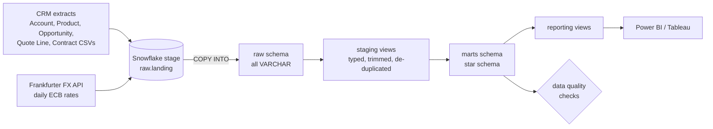
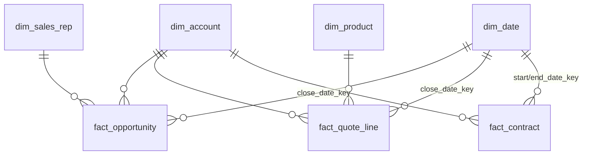

# CRM & Contracts Data Warehouse on Snowflake

An ELT pipeline that turns Salesforce-style CRM, CPQ and contract data into a
**Snowflake star schema** for sales and renewals reporting in Power BI / Tableau.

It covers the full path a data engineering team owns: extracting from files and a
REST API, landing raw data in Snowflake, cleaning and de-duplicating it,
dimensional modelling, currency conversion, reporting views, and automated data
quality checks.

## Architecture



| Layer | What happens |
|---|---|
| **raw** | Files land as-is (every column `VARCHAR`) so a bad value never breaks the load. Loaded with `PUT` + `COPY INTO ... MATCH_BY_COLUMN_NAME`. |
| **staging** | `TRY_CAST` typing, trimming, standardised currency codes, and de-duplication of re-sent records with `QUALIFY ROW_NUMBER()` (latest `last_modified_date` wins). |
| **marts** | Kimball-style star schema with MD5 surrogate keys, integer `YYYYMMDD` date keys and USD conversion using the FX rate on each deal's close date. |
| **reporting views** | Bookings by month and product family, rep win rate and sales cycle, open pipeline, renewals due in 90 days. |

## Data model



| Table | Grain |
|---|---|
| `fact_opportunity` | one row per opportunity (amount in local currency and USD, stage, days to close) |
| `fact_quote_line` | one row per product on an opportunity (quantity, discount, net amount) |
| `fact_contract` | one row per contract (term, status, total and annual contract value) |
| `dim_account`, `dim_product`, `dim_sales_rep`, `dim_date` | conformed dimensions |

## Data quality

`sql/07_data_quality.sql` runs after every build. **Errors** fail the pipeline;
**warnings** are reported:

- duplicate business keys after de-duplication
- orphan foreign keys (opportunity → account, quote line → product)
- missing FX rates, null or negative amounts, unknown dates
- contracts ending before they start
- reconciliation of opportunity amount against the sum of its quote lines

The source data deliberately contains duplicates, whitespace, lowercase currency
codes, missing industries and invalid quantities, so the checks have real issues
to catch.

## Run it

```bash
python -m venv .venv
# Windows: .venv\Scripts\activate    macOS/Linux: source .venv/bin/activate
pip install -r requirements.txt

# Local run (no cloud account): same SQL models on DuckDB
python src/run_pipeline.py --target duckdb

# Snowflake run: copy .env.example to .env and fill in your account
python src/run_pipeline.py --target snowflake

# Tests
pytest -q
```

## Project structure

```
src/
  generate_crm_data.py   Salesforce-style source extracts (CSV)
  extract_fx_rates.py    REST API extract with forward-fill for non-trading days
  run_pipeline.py        extract -> load -> transform -> data quality
sql/
  00_setup.*.sql         warehouse, database, schemas, file format, stage
  01_raw_tables.sql      landing tables
  02_staging.sql         typed, cleaned, de-duplicated views
  03_dim_date.*.sql      calendar dimension (Snowflake GENERATOR / DuckDB range)
  04_dimensions.sql      account, product, sales rep
  05_facts.sql           opportunity, quote line, contract facts
  06_reporting_views.sql BI-ready views
  07_data_quality.sql    checks
tests/
  test_pipeline.py       end-to-end test on DuckDB
```

## Notes

- Source records are synthetic but follow the standard Salesforce object model
  (Account, Product2, Opportunity, QuoteLineItem, Contract), so the same model
  applies to a real Salesforce extract.
- FX rates come from the free [Frankfurter API](https://frankfurter.dev). If the
  API is unreachable, the pipeline falls back to sample rates and marks them
  `source = 'sample'`.
